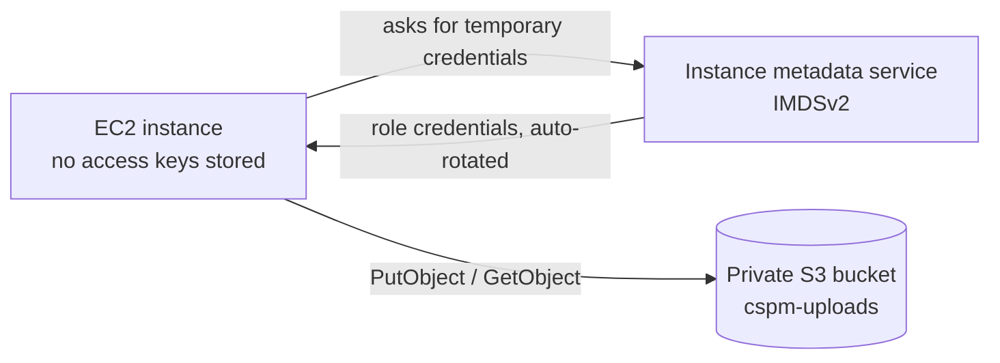

# Giving an EC2 Instance Access to S3 with an IAM Role (No Access Keys)

Hands-on project: I let an EC2 instance upload files to a private S3 bucket using an **IAM role** instead of stored access keys, then widened the role's permissions on purpose to see how much more it could reach.

**Services used:** IAM (roles, inline policies), EC2, S3, STS
**Region:** eu-north-1 (Stockholm)

## How it works



1. The instance has the role `ec2-s3-upload-role` attached.
2. The AWS CLI gets temporary credentials from the instance metadata service, and they rotate automatically.
3. Nothing is stored in `~/.aws/credentials`, so there are no keys to leak.

## 1. Least-privilege setup
- Created a private bucket (Block Public Access on)
- Created an EC2 role with an inline policy allowing only two actions on objects in that one bucket:

```json
{
  "Version": "2012-10-17",
  "Statement": [{
    "Effect": "Allow",
    "Action": ["s3:PutObject", "s3:GetObject"],
    "Resource": "arn:aws:s3:::<UPLOAD-BUCKET>/*"
  }]
}
```

- Attached the role to the instance

Screenshot: `screenshots/01-least-privilege-policy.png`

## 2. Testing it

```bash
echo "Hello from ec2" > test0.txt
aws s3 cp test0.txt s3://<UPLOAD-BUCKET>/test0.txt
aws s3 cp s3://<UPLOAD-BUCKET>/test0.txt downloaded.txt
cat downloaded.txt
```

Upload and download both worked.

Screenshot: `screenshots/02-upload-works.png`

Then I checked what the role could **not** do:

```bash
aws s3 ls
aws sts get-caller-identity
ls ~/.aws/credentials
```

- `aws s3 ls` returned **AccessDenied**, because no policy allows `s3:ListAllMyBuckets`
- `get-caller-identity` showed the instance running as `assumed-role/ec2-s3-upload-role/<instance-id>`
- `~/.aws/credentials` doesn't exist, so no keys are stored on the server

Screenshot: `screenshots/03-denied-identity-no-keys.png`

**Note:** the AWS CLI does create `~/.aws/cli/cache/` on first use. It holds only a session ID, not credentials.

## 3. Breaking it on purpose
I changed the policy to full S3 access on all resources:

```json
{
  "Version": "2012-10-17",
  "Statement": [{
    "Effect": "Allow",
    "Action": "s3:*",
    "Resource": "*"
  }]
}
```

**Result:** the same instance could now list every bucket in the account and read the contents of my unrelated static-website bucket.

Screenshots: `screenshots/04-broad-policy.png`, `screenshots/05-broad-policy-lists-all-buckets.png`

**Why it matters:** if an attacker gets a shell on the instance, or finds a bug that lets them make requests from it, they can use the role's credentials too. The broader the role, the more they can read, change, or delete. I restored the least-privilege policy afterwards.

## 4. Before vs after

| | Least privilege | Broad (`s3:*` on `*`) |
|---|---|---|
| Actions | `PutObject`, `GetObject` | All S3 actions |
| Resources | One bucket's objects | Every bucket |
| `aws s3 ls` | AccessDenied | Lists all buckets |
| Blast radius if the instance is compromised | One bucket | The whole account's S3 |

## 5. What I learned
- Roles give an instance **temporary, auto-rotating credentials**, so there are no long-term keys on disk
- Scope policies to specific **actions** and **resources**, not wildcards
- `AccessDenied` messages tell you exactly which action was missing, which makes debugging least-privilege policies easier
- IMDSv2 was required on my instance, which limits some attacks on the metadata service

## 6. What a CSPM could check
- IAM policies with `"Action": "*"` or `"Resource": "*"`
- Roles attached to instances with broader S3 access than they use
- Long-lived access keys older than 90 days (the problem a role avoids)
- Instances that still allow IMDSv1

## 7. Next steps
- Rebuild the VPC, bucket, and role in **Terraform**, and scan them with **Checkov**
- Build a mini-CSPM in Python (boto3) that flags the findings above